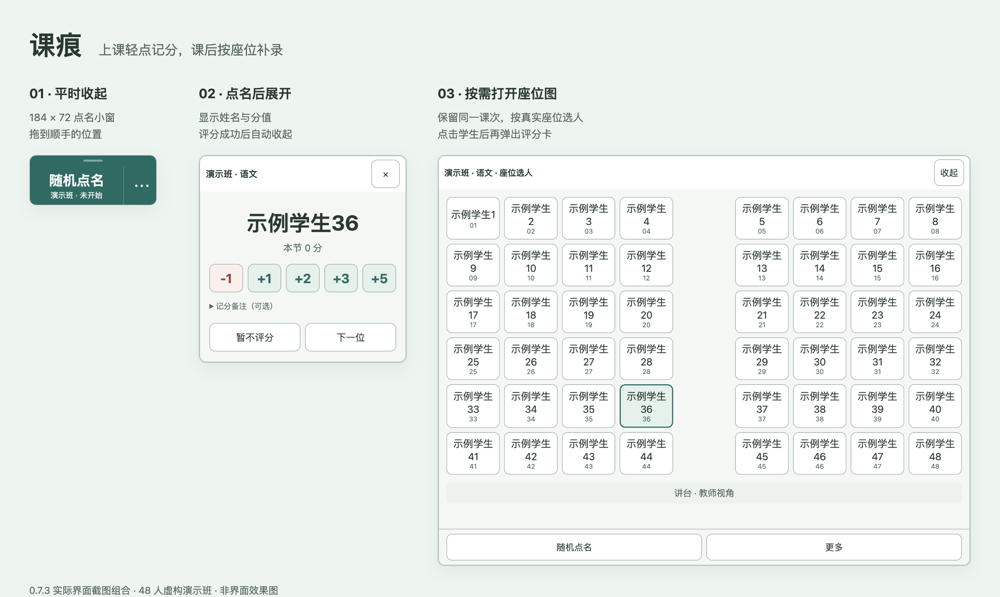
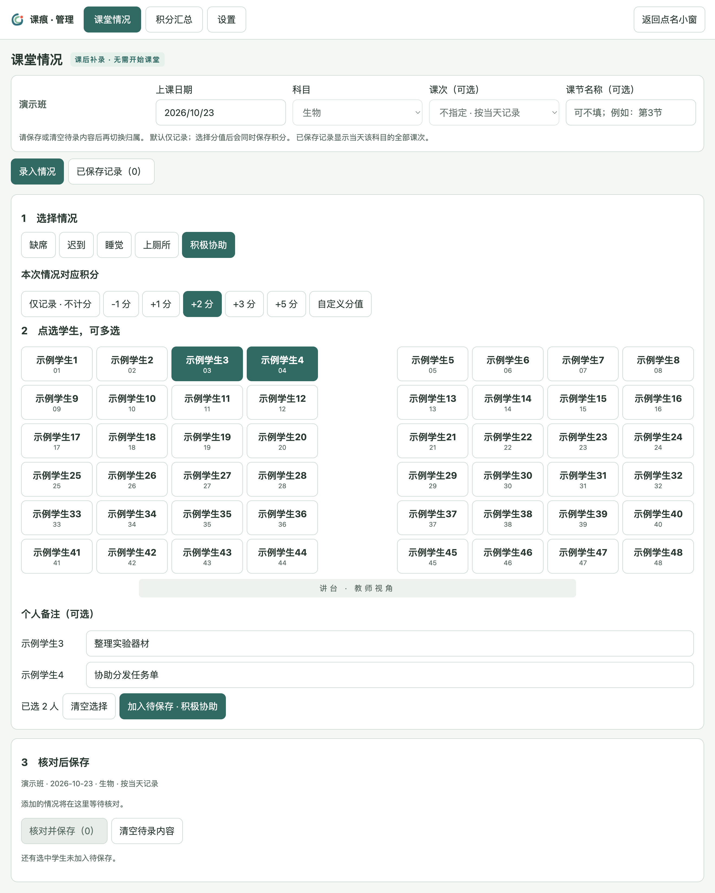
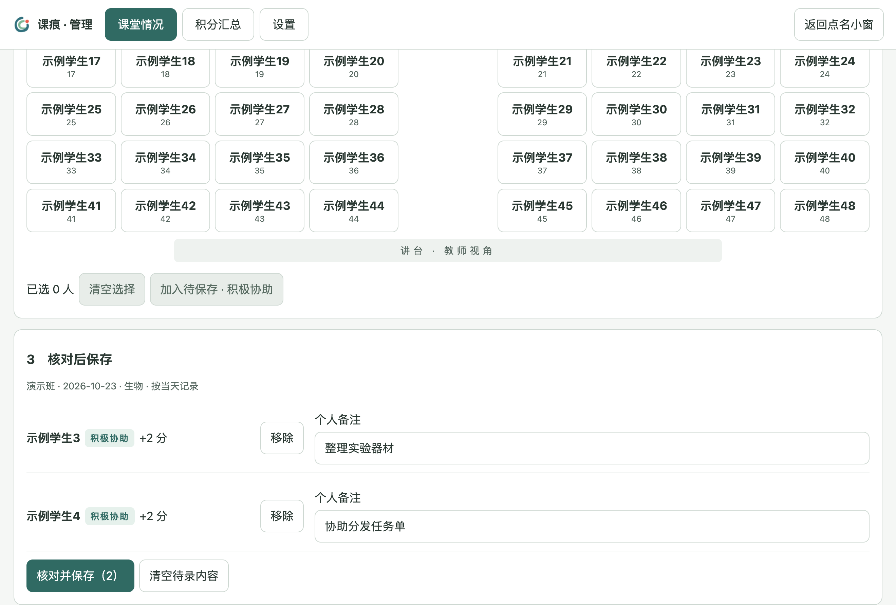
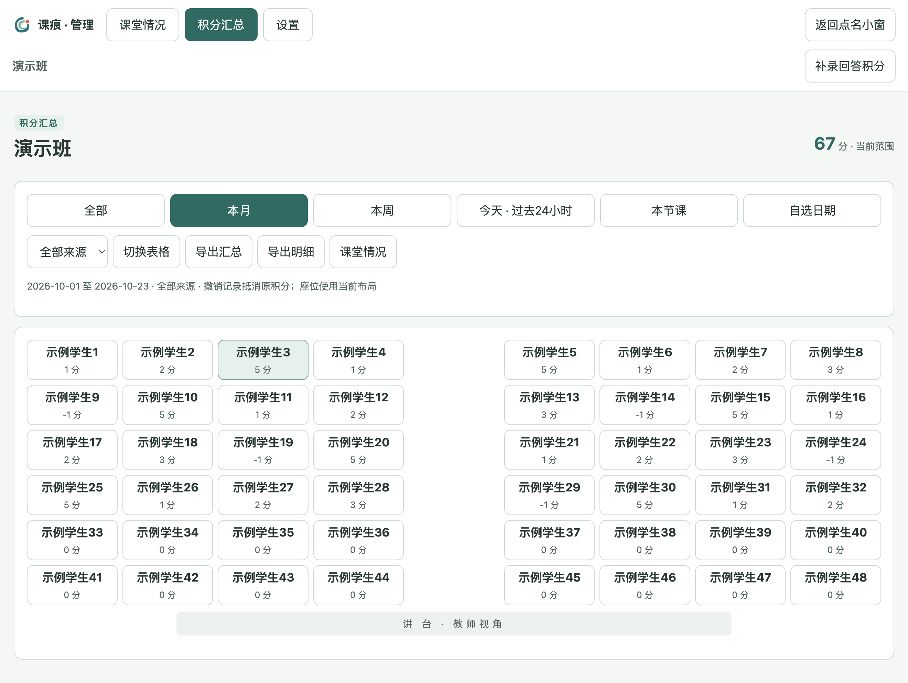
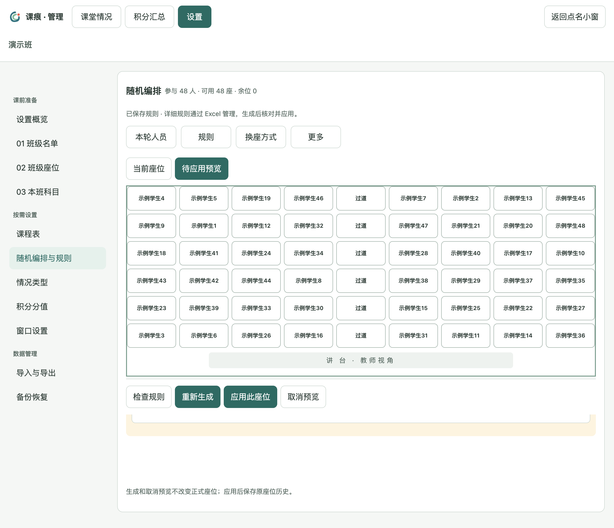
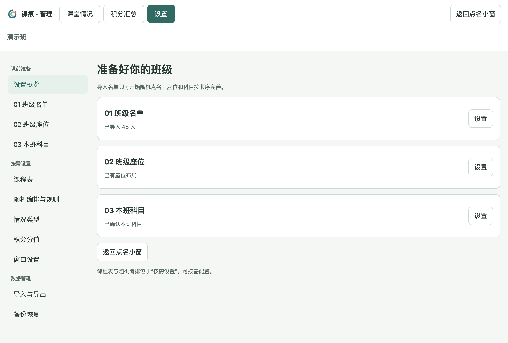
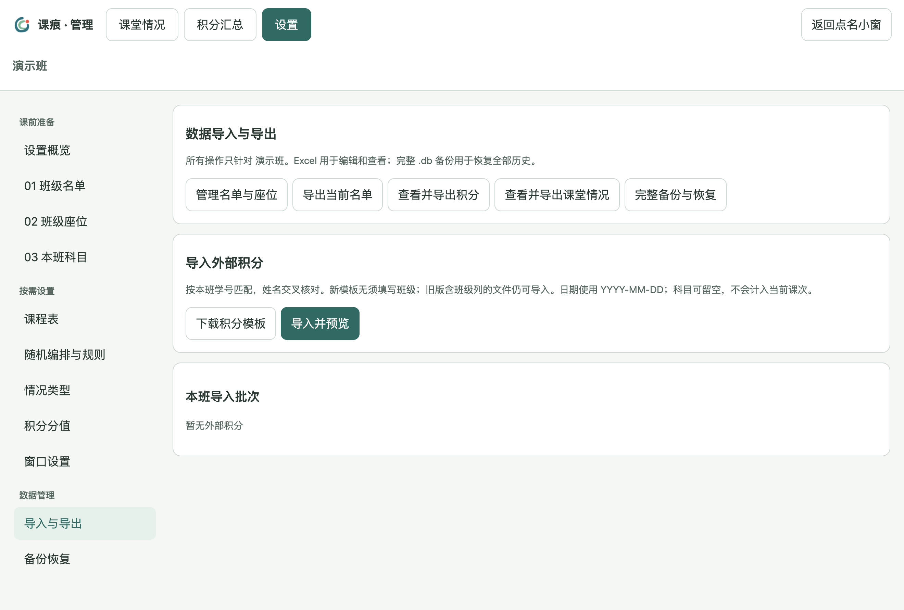

<p align="center">
  
</p>

# 课痕 · 课堂互动与记录

**上课轻点记分，课后按座位补录，让一个班的课堂记录更顺手。**

课痕（原名「课堂积分」）是一款面向教师日常教学的离线桌面工具，围绕一个班级组织随机点名、座位选人、回答积分、课堂情况、积分汇总和座位编排。上课时保留紧凑的小窗，需要记分才展开；课后的录入和设置在独立管理窗口完成。

`当前版本 0.7.4-beta.1 · 公开测试版` · `离线使用` · `单班级工作流` · `Windows x64 / macOS Apple 芯片` · `Excel 导入导出`



> 本文图片来自 0.7.3 的实际程序界面，使用隔离的演示数据库和 48 名虚构学生；排版展示图只组合了真实截图。截图采集日期：2026-10-23。

[快速上手](#快速上手) · [功能介绍](#功能介绍) · [获取与运行](#获取与运行) · [数据与更新](#数据与更新) · [完整使用说明](使用说明.md)

## 名称与 Logo

「课痕」记录一堂课里留下的回答、表现与变化。Logo 采用 **B「点选回响」**：暖色圆点代表一次点选，双弧线表达互动之后持续保留的记录。图形用于桌面、任务栏、Dock 和管理窗口；完整名称用于文档与软件标题。

本次更名保留应用标识和原 `classroom-points` 数据目录；旧版数据库与完整备份可以继续使用。[图标尺寸与更新说明](docs/0.7.2-课痕名称与图标更新.md)。

界面以 Logo 衍生的深青绿色作为操作主色，白色与浅灰绿承载内容；扣分、提醒和保存成功使用各自的语义颜色。正文和提示文字优先保证对比度，详见 [0.7.3 配色说明](docs/0.7.3-深青绿主题与可读性.md)。

本轮修复数据库关联约束、备份保留顺序和名单状态往返，便携 ZIP 与解压目录统一带版本、系统及架构。详见 [0.7.4 Beta 1 更新说明](docs/0.7.4-beta.1-可靠性修复与发行命名.md)。

## 为什么做这个工具

课堂上，老师需要的是随手点名和快速记分；课后，科班长需要按座位核对多人情况；整理积分时，又希望直接查看本周、本月或某节课，而不用重新拼表格。

课痕把这些操作放进同一个本地工具中：课堂小窗负责当下互动，管理窗口负责课后整理，Excel 继续承担名单、座位和详细规则的编辑。

## 功能介绍

### 1. 上课时，只保留需要的操作

默认点名小窗为 **184 × 72**，可拖动、可置顶。点名后展开姓名与分值按钮，评分成功后自动收起；等待学生回答时，评分卡会保留。也可以暂不评分或继续点下一位。

- 随机点名与座位选人共用同一课次，切换时保留当前学生和已记录积分。
- 座位图按实际布局显示，保留过道与空位；点击学生才弹出评分卡。
- 分值按钮可在设置中调整，支持加分、扣分和记分备注；误操作可以撤销并保留痕迹。
- 每次随机抽取相互独立，允许重复抽中同一学生。

### 2. 课后按座位批量录入，分别填写备注

无需先开始课堂。选择日期和科目后，即可按座位多选学生，记录迟到、缺席等情况；课次可选，也可只记到当天。情况类型可以在设置中添加或删除。



每批可以选择“仅记录 · 不计分”，也可以使用预设或自定义分值，正数加分、负数扣分。先加入待保存列表，再核对人员、备注与分值，整批保存。每个人都可以填写自己的备注。



回答积分也支持课后批量补录：同样按座位多选，设置每人分值，分别填写备注后保存。删除情况类型不会删除已经保存的历史记录；撤销情况时会同步撤销其关联积分。

### 3. 积分汇总，一键切换常用范围

提供 **全部、本月、本周、今天 · 过去24小时、本节课、自选日期** 六种范围。支持按科目筛选，在座位图与表格之间切换，并查看每名学生的积分明细。



- 汇总表可按学号、加分、扣分量或净积分排序，导出沿用当前筛选与排序。
- 关联课次的积分按上课开始时间归入统计，课后补录也归到原课堂。
- 未关联课次、只有日期的旧记录，在“过去24小时”的起始日按整日近似计入，界面会提示。
- 历史积分使用当前座位图展示；停用或未排座但仍有记录的学生会保留在统计中。

### 4. 座位用姓名编辑，规则继续在 Excel 中管理

座位模板直接填写姓名，不要求在座位格里填写学号。可以手动安排，也可以导入 Excel；遇到重名时逐项核对，或设置座位专用显示名。

详细排座规则集中在三张 Excel 编辑表：**座位设置、学生规则、配对避邻**。程序中按“检查规则 → 生成预览 → 核对并应用”操作，预览本身不会改动正式座位。



- 可以设置分区、固定位置、配对避邻、横向换组，以及标记学生两侧前部优先。
- 临时不参与排座的学生可在“本轮人员”中取消勾选；多余座位可以保留为空。
- 导入当前座位时，可选择仅更新座位，或同步新增、恢复和停用名单。
- 应用新座位后保存历史，便于查看或恢复。

### 5. 基础设置与进阶设置分开

课前准备依次是班级名单、班级座位和本班科目。课程表、排座规则、情况类型和分值在“按需设置”中配置，数据导入导出与备份另设入口。



名单支持添加个别学生、停用、恢复和删除，便于处理转入、暂离班等变化。可选配置周课程表，软件运行期间按本机时间自动跟课；完全退出后不会执行自动跟课。

## 快速上手

1. **导入名单**：打开小窗的“⋯ → 设置 → 班级名单”，建立本班，下载模板，填写学号与姓名后导入。完成这一步即可随机点名。
2. **完善座位与科目**：下载姓名座位模板，修改后导入并核对；勾选本班实际使用的科目。
3. **开始课堂**：回到点名小窗，点击“随机点名”，确认科目后开始；也可从“⋯”进入座位选人。
4. **课后整理**：打开课堂情况或补录回答积分，批量选人、填写备注、核对保存；在积分汇总中选择范围并导出。
5. **定期备份**：进入“设置 → 备份恢复”，导出完整 `.db` 备份。

首次试用也可以在空数据库中载入软件自带的 48 人演示班。更详细的步骤见 [使用说明](使用说明.md)。

## 获取与运行

| 系统 | 交付形式 | 运行方式 |
| --- | --- | --- |
| Windows x64 | [Windows 安装版](https://github.com/tideyzhang/kehen/releases/download/v0.7.4-beta.1/%E8%AF%BE%E7%97%95-0.7.4-beta.1-Windows-x64-%E5%AE%89%E8%A3%85%E7%89%88.exe) | 按安装向导安装后运行 |
| Windows x64 | [Windows 便携版](https://github.com/tideyzhang/kehen/releases/download/v0.7.4-beta.1/%E8%AF%BE%E7%97%95-0.7.4-beta.1-Windows-x64-%E4%BE%BF%E6%90%BA%E7%89%88.zip) | 完整解压，运行其中的程序；保留全部文件 |
| macOS Apple 芯片 | [Mac Apple 芯片版](https://github.com/tideyzhang/kehen/releases/download/v0.7.4-beta.1/%E8%AF%BE%E7%97%95-0.7.4-beta.1-macOS-arm64.zip) | 解压后打开 `课痕.app` |

便携包解压后的顶层文件夹与 ZIP 同名（不含扩展名），内部仍运行 `课痕.exe`。下载附件可用 `SHA256SUMS.txt` 校验。

从 [Releases 下载当前测试版](https://github.com/tideyzhang/kehen/releases/tag/v0.7.4-beta.1)。请选择下方安装版或便携包，GitHub 自动生成的 Source code 是源码，不能直接作为程序运行；本地构建产物位于 `dist/`。便携版不要在压缩包中直接运行，换电脑前退出程序并复制整个文件夹。

当前发行包未做发行者代码签名。Mac 已完成核心数据与桌面流程验证；Windows 需结合教室电脑检查安装、触屏、显示缩放和全屏课件置顶，详见 [Windows 实机验收清单](Windows实机验收清单.md)。

## 数据与更新

程序无需登录账号，核心功能离线运行。数据保存在本机 SQLite 数据库中；安装版使用应用数据目录，Windows 便携版使用程序旁的 `data/` 文件夹。



| 文件 | 用途 |
| --- | --- |
| 名单 Excel | 导入学生，导出当前名单与在班状态；导入可选“状态”列 |
| 座位 Excel / CSV | 按姓名编辑、交换当前座位布局 |
| 排座规则 Excel | 编辑座位设置、学生规则与配对避邻 |
| 课程表 Excel | 编辑、导入周课程表 |
| 积分 / 情况 Excel | 交换积分数据，导出当前筛选范围的汇总、明细或课堂情况 |
| 完整 `.db` 备份 | 恢复名单、座位、积分、课堂情况及相关设置 |

**Excel 报表不能替代完整数据库备份。** 每日首次启动及数据导入前会自动备份，自动备份校验成功后按时间保留最近 30 份；手动完整备份可另存到其他位置。

0.7.4-beta.1 沿用现有数据库结构，已将 0.5.0、0.6.0 数据样本的读取与恢复纳入兼容测试。更新前先导出完整备份：安装版沿用原数据目录；便携版退出后，将旧版 `data/` 文件夹完整复制到新版旁边。

模板、Excel/CSV 导出和手动 `.db` 备份默认带导出时的本机日期与时间，例如 `演示班-排座规则-2026-10-23_16-30-00.xlsx`。导入保留原文件名与内容。

## 开发与验证

使用 Electron、JavaScript、SQLite（sql.js）和 ExcelJS 构建。

```sh
npm ci
npm start
npm test
```

桌面流程验证：

```sh
npm run test:ui
npm run test:planning-ui
npm run test:feedback-ui
npm run test:workspace-ui
npm run test:roster-ui
npm run test:seating-ui
npm run test:brand-ui
npm run test:reliability-ui
```

构建交付包：

```sh
npm run pack:mac
npm run build:win
npm run build:portable
```

`src/` 存放程序源码，`test/` 存放数据与算法测试，`scripts/` 存放桌面流程验证与构建脚本。既有版本的验证结果见 [测试记录](测试记录.md)。

## 更多说明

- [完整使用说明](使用说明.md)
- [版本功能与兼容记录](docs/版本功能与兼容记录.md)
- [姓名座位、简化规则与升级说明](docs/0.7.0-座位规则简化与升级说明.md)
- [换座方式与文件命名说明](docs/0.7.1-换座方式与文件命名说明.md)

反馈问题时，请说明软件版本、系统、操作步骤和预期结果；涉及名单或截图时，使用演示数据或先隐去真实学生信息。

## 开放许可与参与

源码及随附的自有文档、正式图形按 [MIT 许可证](LICENSE) 提供，允许修改、商用及再分发，须保留版权和许可声明。第三方组件遵循 [各自许可](THIRD_PARTY_NOTICES.md)，名称和 Logo 的说明见 [BRAND.md](BRAND.md)。

欢迎提交 [错误反馈与建议](https://github.com/tideyzhang/kehen/issues)，参与修改前请阅读 [贡献指南](CONTRIBUTING.md)。请使用虚构示例，不上传实际学生信息；安全问题见 [SECURITY.md](SECURITY.md)。

公开 Git 历史从当前版本的干净基线开始；旧本地开发历史另作完整归档。版本采用主版本号、次版本号、修订号及测试版后缀，见 [CHANGELOG](CHANGELOG.md)。
