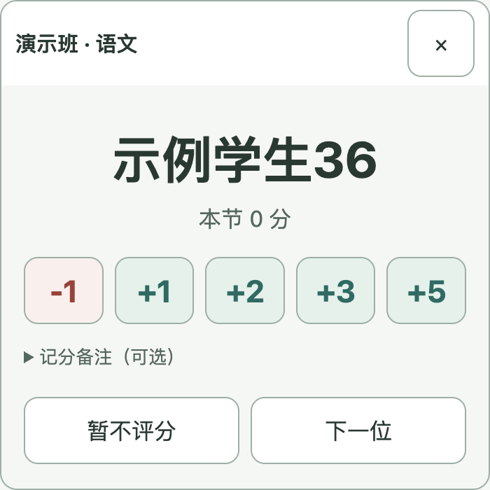

# 课痕 0.7.3 · 深青绿主题与可读性

日期：2026-10-23。本版根据正式 Logo「点选回响」调整应用配色，操作流程、窗口尺寸、数据目录和数据库格式沿用 0.7.2。

## 配色原则

- **深青绿用于操作重点**：主按钮、当前导航、选中学生、点名小窗及勾选框使用同一主色。
- **内容仍以浅色承载**：页面采用浅灰绿，卡片和输入区域使用白色；正文使用深灰绿，避免大面积深色背景。
- **语义色独立**：扣分和错误保留深红，提示使用暖色，成功反馈使用绿色。图标中的亮红点不直接复制为正文或大面积背景。
- **明暗优先于原色复刻**：主色由 Logo 的青绿色衍生并适当加深，以保证白字可读；浅色选中区配深色文字。
- **减少过度淡化**：禁用按钮使用明确的灰底、灰绿文字和边框，保留禁用行为；学生学号不再依靠低透明度淡化。
- **保留焦点提示**：普通控件采用深青绿焦点环；深色点名按钮使用内嵌白色焦点环。

## 主要颜色与实测组合

| 场景 | 文字 / 前景 | 背景 | 对比度约值 |
| --- | --- | --- | --- |
| 主按钮、小窗 | 白色 `#FFFFFF` | 深青绿 `#0D6B63` | 6.36:1 |
| 正文 | 深灰绿 `#263832` | 白色 `#FFFFFF` | 12.40:1 |
| 说明文字 | 灰绿 `#52675F` | 页面 `#F4F7F5` | 5.62:1 |
| 浅色选中区 | 深青绿 `#0D6B63` | 浅绿 `#E3F1EC` | 5.47:1 |
| 扣分按钮 | 深红 `#A53D36` | 浅红 `#FBEFED` | 5.62:1 |
| 禁用按钮 | 灰绿 `#526B60` | 灰底 `#E7EDE9` | 4.87:1 |

检查时参考 [W3C 对文字对比度的说明](https://www.w3.org/WAI/WCAG22/Understanding/contrast-minimum.html)，以普通文字至少 4.5:1 作为本轮所检查配色的目标。该检查不等同于完整的无障碍合规评估。

## 实际界面检查

对设置概览、点名小窗、评分卡、座位选人、情况多选、待保存核对、积分汇总、排座预览和数据管理共 9 个界面/状态，读取实际界面的计算样式，检查文字、输入值及占位文字与背景的对比度，同时查看实际截图。

共检查 690 个文字或输入元素，最低对比度约为 4.87:1，未出现低于本轮目标的可用文字组合。半透明文字会按叠加背景计算；这些结果只覆盖采集状态，未把 Logo 图形或系统原生弹出层计为普通文字，也不能替代教室屏幕、投影和不同缩放下的现场查看。

## 数据与更新

本次只调整主题样式与窗口加载背景，并更新版本及文档；数据库结构、应用标识、原 `classroom-points` 数据目录、积分计算和导入导出逻辑不变。旧数据和完整 `.db` 备份继续可用。

安装版运行 `课痕 Setup 0.7.3.exe`；便携版完整解压新版 ZIP，并在退出旧程序后复制原 `data` 文件夹。更新前仍先导出完整备份。Windows 教室屏幕、触屏和投影效果按 [实机验收清单](../Windows实机验收清单.md) 继续确认。
