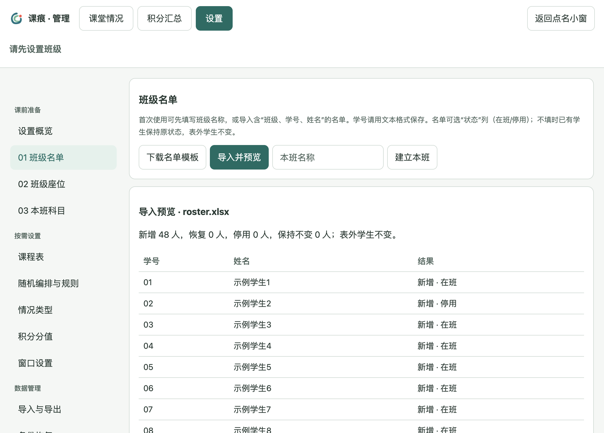

# 课痕 0.7.4 Beta 1：可靠性修复与发行命名

日期：2026-10-23。版本：`0.7.4-beta.1`。本版作为 GitHub 首次公开测试版，代码采用 MIT 许可，安装包通过 Releases 分发。

## 修复内容

### 数据保存与关联约束

统一数据库导出，保存、事务快照、自动及手动备份后恢复关联约束；事务失败回滚和恢复数据库后同样保持。继续使用临时文件、刷盘和替换原文件的保存方式。

打开已有数据库时检查完整性和关联记录；异常时保留原文件并报错，不自动删改或修补。数据库结构、应用标识和安装版原 `classroom-points` 数据目录保持不变，旧版完整备份仍可读取。此修复防止新增异常关联，不代表会自动修复既有异常数据。

### 自动备份

新备份写入并校验成功后，按文件名中的时间戳保留最近30份；旧名称无法识别时间戳时使用修改时间。本次新备份保留，同毫秒生成的备份不覆盖。写入或校验失败时不清理旧备份。

每日首次启动、导入前、删除前和恢复前等备份时机保留。

### 名单导出再导入

截图来自隔离的48人虚构演示班。名单增加可选“状态”列的识别：

| 输入 | 结果 |
| --- | --- |
| 在班 / 停用 | 应用明确状态 |
| 无状态列或空白 | 新生在班，已有学生保持原状态 |
| 其他非空内容 | 提示行号，整批拒绝 |
| 表外学生 | 原状态不变 |
| 匹配已删除学号 | 拒绝隐式恢复，提示核对 |

预览显示新增、恢复、停用与保持不变；提交时再次校验。停用移除当前座位，但保留历史积分、情况和排座规则；正在上课时不能改变已有学生的在班状态。

### 依赖

将受影响的间接依赖 `brace-expansion` 1.x、2.x 分别定向更新到 `1.1.21`、`2.1.7`，锁定文件同步更新。首次公开前补充许可检查，将 ExcelJS 的解压依赖 unzipper 定向更新为 0.12.5，移除旧 binary/buffers/chainsaw 依赖链；重新验证 Excel 流程，并附第三方许可原文。

## 统一文件命名

| 用途 | 名称 |
| --- | --- |
| Windows x64 安装 | `课痕-0.7.4-beta.1-Windows-x64-安装版.exe` |
| Windows x64 便携 | `课痕-0.7.4-beta.1-Windows-x64-便携版.zip` |
| ZIP 内顶层目录 | `课痕-0.7.4-beta.1-Windows-x64-便携版` |
| 目录内主程序 | `课痕.exe` |
| Mac Apple 芯片 | `课痕-0.7.4-beta.1-macOS-arm64.zip`，解压为 `课痕.app` |
| 三份附件校验 | `SHA256SUMS.txt` |

版本名称由软件配置生成。Excel、CSV、手动数据库备份的日期时间文件名保持原规则。

## 更新与验证边界

更新前导出完整 `.db`。安装版沿用旧数据目录；便携版先退出旧程序，再将整个旧 `data` 文件夹复制到新版 `课痕.exe` 旁边，不要用新空目录覆盖旧数据。

自动测试、桌面流程及成品检查结果见 [测试记录](../测试记录.md)。本版仍未做发行者代码签名；Windows 教室实机的安装、触屏、显示缩放、PPT 置顶及实际数据升级继续按 [实机验收清单](../Windows实机验收清单.md) 确认。
